<picture>
  <source media="(prefers-color-scheme: dark)" srcset="./assets/poster-dark.svg">
  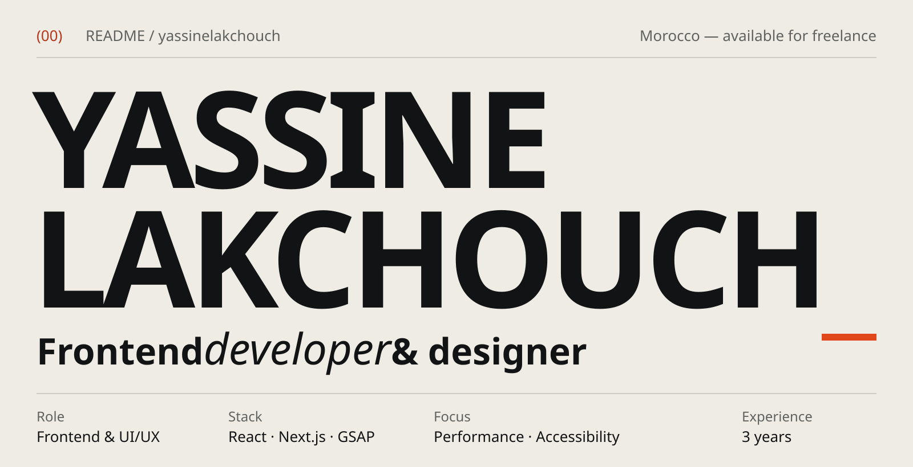
</picture>

I build interfaces that are quick to load, easy to use and pleasant to move through — from the first wireframe to the shipped React code. Three years in, my work sits between design and frontend: Figma on one side, React, TypeScript and GSAP on the other.

### Stack

<picture>
  <source media="(prefers-color-scheme: dark)" srcset="./assets/stack-dark.svg">
  
</picture>

React · TypeScript · Next.js · Tailwind CSS · GSAP · Framer Motion · WebGL · Figma · Photoshop · Node.js · MongoDB

### How I work

1. Brainstorm
2. Persona & journey
3. Wireframes
4. High fidelity
5. Build & launch

### Contact

Email: [yassinelakchouch@gmail.com](mailto:yassinelakchouch@gmail.com) · LinkedIn: [Yassine Lakchouch](https://www.linkedin.com/in/yassine-lakchouch-5917a8241/) · Portfolio: not deployed yet

### Off the clock

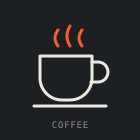
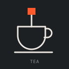
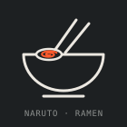
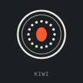
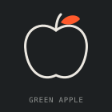
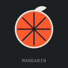
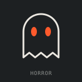

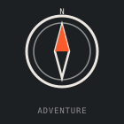
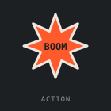

